# Proton Drive Auto-Mount for Linux

Mount your Proton Drive as a local folder at `~/ProtonDrive` with **zero-persistence security** — no session tokens are ever left on disk after you unmount, and your password lives in your **OS secret store** (KWallet / GNOME Keyring), not a plaintext file.

On first run, the script walks you through setup with simple popups. After that, mounting is one click (or one command) — only the current 2FA code is required.

> **Status:** tested and working on **Ultramarine Linux 44 — KDE Plasma (Fedora 44 base) with KWallet**. A GNOME Keyring version exists but is still being polished — it will land on a separate branch.

## Target environment

**KDE Plasma** (uses `kdialog`) and **GNOME / other desktops** (uses `zenity`) — the scripts auto-detect whichever is installed. A terminal-only fallback also works over SSH.

Tested on: **Ultramarine Linux 44 — KDE Plasma (Fedora 44 base)**, rclone v1.74.3. GNOME/zenity and GNOME Keyring paths are built in but not yet field-tested.

## How it works

| Moment | What happens |
|---|---|
| First run | Username + password wizard → password is saved to your OS secret store (KWallet or GNOME Keyring); username and settings live in `~/.config/proton-automount.env` (mode 600) |
| Every mount thereafter | Credentials pulled from the secret store → **2FA step only** (YubiKey touch or TOTP popup) → mount |
| Reinstall (password kept) | Username only is asked → you're offered reuse of the stored password |
| Drive mounted | The rclone daemon's session lives **in RAM only** — tokens are purged from disk |
| Unmount (Dolphin or script) | Stays unmounted. Nothing remounts until you run the script again |
| Account has no 2FA | Leave the TOTP popup empty — logs in with password only |

Between sessions, there are no valid session tokens anywhere on disk — every mount requires a genuine, current 2FA code (when 2FA is enabled on the account).

## Requirements

- rclone **v1.64.0 or newer** (that's when the Proton Drive backend was added)
- FUSE / fuse3
- `kdialog` (KDE Plasma) **or** `zenity` (GNOME and most desktops)
- A secret store for best results: `kwallet-query` (KDE) or `secret-tool` (libsecret, GNOME/others) — falls back to storing the password in the env file only when no keyring is available
- Optional: `ykman` (YubiKey automatic TOTP), `notify-send` (desktop notifications)

> ⚠ Note: rclone has flagged the Proton Drive backend as **unmaintained**. Newer rclone versions can be hit-or-miss — tested working on v1.74.3.

## Install

```bash
./install.sh
```

Installs rclone, FUSE, ykman, libsecret and libnotify for your distro (dnf / apt / pacman / zypper detected automatically). It installs `zenity` if no `kdialog` is present, verifies your rclone version is ≥ 1.64, and creates **Proton Drive** menu launchers (including a right-click **Uninstall** action):

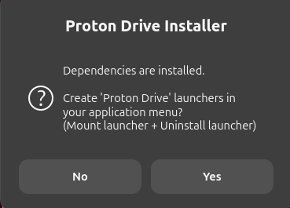

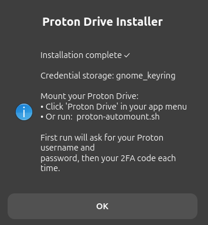

## First run

```bash
./proton-automount.sh
```

A popup asks for your Proton username:

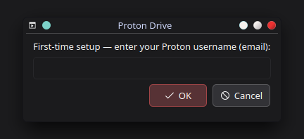

Then your password (input is hidden):

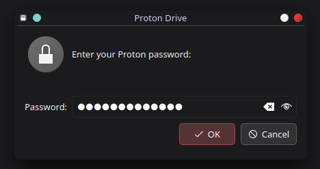

If an OS secret store (KWallet / GNOME Keyring) is available, the password is stored there — kept out of the env file entirely:

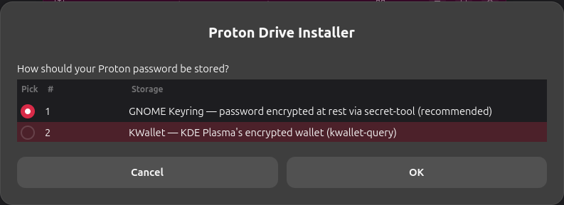

Settings and your username (the secret-store lookup key — not itself a secret) live in `~/.config/proton-automount.env` with owner-only permissions (`600`):

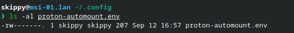

Then you're asked for your 2FA code (see YubiKey section below, or type the code manually). The drive mounts at `~/ProtonDrive` and a notification confirms it.

## Where credentials live (and what the script will never touch)

The script uses a dedicated `[AUTO]` namespace for all keyring access — entries are stored under the private KWallet folder `ProtonRcloneAuto` / the GNOME Keyring group `proton-rclone-auto`, as `[AUTO]<username>:password`. Because of this prefix and isolation, the script **can never read, overwrite, or delete your own (human-created) keyring entries** — including any you made yourself for Proton.

If no secret store is available, the password falls back to the env file — see *Honest limits* below.

## YubiKey automatic 2FA (optional)

If a YubiKey is plugged in, the script reads the current TOTP code straight off the key — you just touch it, no typing.

**No setup needed for most users:** the script automatically finds a YubiKey credential whose name contains your Proton username, preferring credentials issued by Proton Mail. Plug in your key, run the script, touch the key when prompted — that's it.

**If auto-detection fails or picks the wrong credential,** list your credential names:

```bash
ykman oath accounts list
```

(Example output: `Proton Mail:you@example.com`)

Then open `proton-automount.sh` and set the credential in the `YK_CRED` variable near the top of the script:

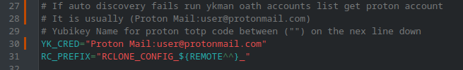

That line has nothing else on it, so even very long credential names are safe to paste — nothing else can break. A manual `YK_CRED` always overrides auto-detection.

If **multiple** credentials match your username and none are Proton Mail credentials, the script refuses to guess — it lists the candidates in the log (`~/.local/state/proton-mount.log`) so you can pick the right one for `YK_CRED`.

Tip: the credential should have touch **enabled** (Yubico Authenticator app → credential → settings). The script waits 30 seconds for a touch and pops a dialog telling you to touch the key.

No YubiKey? Skip this entirely — you'll get a TOTP popup instead. No 2FA on your account at all? Leave the popup empty and it logs in with password only.

## Everyday use

- **Mount:** click **Proton Drive** in your application menu (created by the installer), or run `./proton-automount.sh`. Touch your YubiKey or enter the current code. Done.
- **Unmount:** right-click `~/ProtonDrive` → Unmount in Dolphin, or run `./proton-automount.sh unmount`.
- **Remount:** just run the script again — only the 2FA step repeats.

Logs live at `~/.local/state/proton-mount.log` if anything ever misbehaves (includes rclone's own mount output).

## Security model

The script enforces a strict credential lifecycle:

1. **Credential storage** — your Proton password is stored in your OS secret store (KWallet / GNOME Keyring) under the isolated `[AUTO]` namespace. Your username and non-secret settings live in `~/.config/proton-automount.env` with `600` permissions. Credentials are never written to `rclone.conf`.

2. **At login start** — any cached `[protondrive]` section in `rclone.conf` (access/refresh tokens, salted key) is deleted. This *forces* a fresh login using stored credentials + a current 2FA code.

3. **During mount** — credentials are passed to rclone via environment variables (`RCLONE_CONFIG_PROTONDRIVE_*`) and `rclone obscure` is applied at runtime.

4. **After mount** — the `[protondrive]` section in `rclone.conf` is purged again within seconds of the mount coming up. The daemon keeps its session in memory only.

5. **On unmount** (via the script) — purged again.

Net effect: backend tokens exist on disk only for the brief login window. `rclone config delete` removes *only* the `[protondrive]` section — any other remotes you keep in `rclone.conf` are untouched.

**Honest limits of this design:**

- If **no** OS secret store is available, the password falls back to being stored in `~/.config/proton-automount.env` in plaintext, protected by `600` file permissions. On a fresh install, the script prefers an available secret store over this fallback — it never silently downgrades to a disk-stored password.
- `rclone obscure` is used at runtime, but it's encoding, not encryption.
- If you unmount from Dolphin rather than the script, stale tokens sit inert in `rclone.conf` until the next script run purges them.

## ⚠ Do NOT rm -rf through the mount

While `~/ProtonDrive` is mounted, it **is** your Proton Drive — not a copy. Deleting files through the mount deletes them from the cloud. A careless `rm -rf ~/ProtonDrive/*` while mounted destroys cloud data, likely permanently. Be careful with cleanup commands that match the mountpoint while it's mounted.

## Uninstall

```bash
./uninstall.sh
```

Or right-click the **Proton Drive** menu entry and choose **Uninstall Proton Drive**. If the drive is mounted, the uninstaller refuses and tells you to unmount first:

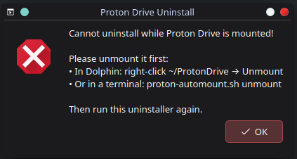

Because deleting a saved password is irreversible, removing the stored keyring password requires **typed confirmation** — a popup shows exactly which entry will be deleted before anything happens:

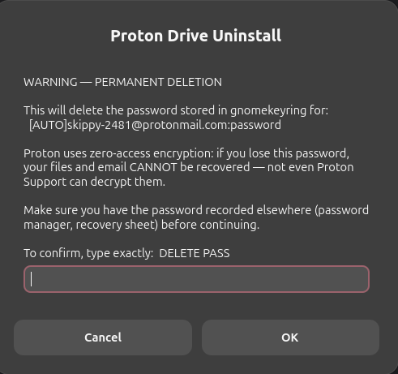

After confirming, it removes saved credentials (env file and keyring entry), rclone backend tokens, VFS caches, the mountpoint, and the log — everything:

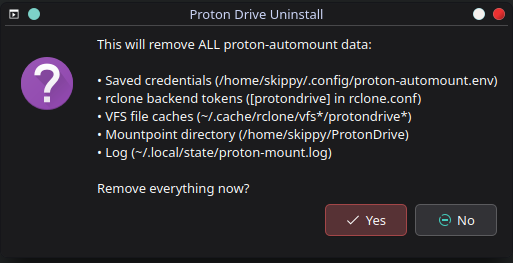

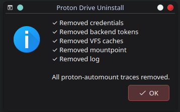

It only removes the `[protondrive]` section from `rclone.conf`, so other remotes are safe.

## Project files

| File | Purpose |
|---|---|
| `proton-automount.sh` | Mount script (run this) |
| `install.sh` | Dependency installer + launcher creation (dnf/apt/pacman/zypper) |
| `uninstall.sh` | Full cleanup / removal |

## Known limitations

- GNOME/zenity and GNOME Keyring support is built in but not yet field-tested — verify on a GNOME install before relying on it (a polished GNOME variant is planned for a separate branch)
- Each mount performs a full login (SRP + 2FA), which takes a few seconds longer than cached-credential mounts — that's intentional
- Repeated failed logins can hit Proton's rate limiting; wait a few minutes if you mistype your password/2FA several times
- Accounts using hardware-security-key-only 2FA (FIDO2) are not supported — TOTP-based 2FA is required

## Changelog

### v1.3.1

- **Secret-store credentials** — the Proton password now lives in KWallet (`kwallet-query`) or GNOME Keyring (`secret-tool`) under a collision-safe `[AUTO]` namespace, instead of a plaintext env file; the username (lookup key, not a secret) stays in the env file
- **Reinstall reuse** — reinstalling with the password kept asks for the username only and offers reuse
- **No silent downgrade** — on fresh installs with no recorded backend, an available OS secret store is preferred over the env-file fallback
- **Safe keyring cleanup** — the uninstaller removes the stored password only after typed confirmation, and never touches keyring entries the script didn't create

### v1.2.0

- **Cross-desktop dialogs:** kdialog → zenity → terminal fallback, auto-detected at runtime
- **YubiKey credential auto-detection** — no placeholder editing; manual override via `YK_CRED` if needed
- **Installer now creates menu launchers** automatically, including a right-click uninstall action
- **Fixed:** instructional comments severing a line continuation had silently disabled the 30-second YubiKey touch timeout since the first release
- **Fixed:** cancelled/lingering dialogs staying on screen (backgrounded function created a subshell that survived the kill)
- **Fixed:** passwords beginning with `-` breaking `rclone obscure` (argument terminator `--` added)
- Uninstaller detects and terminates a lingering rclone daemon

## License

MIT — see [LICENSE](LICENSE)
